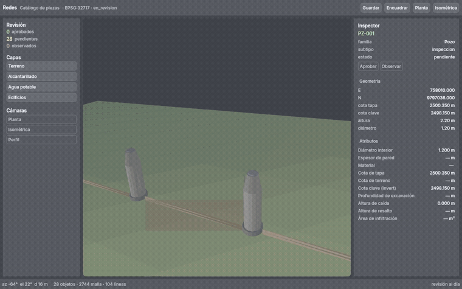
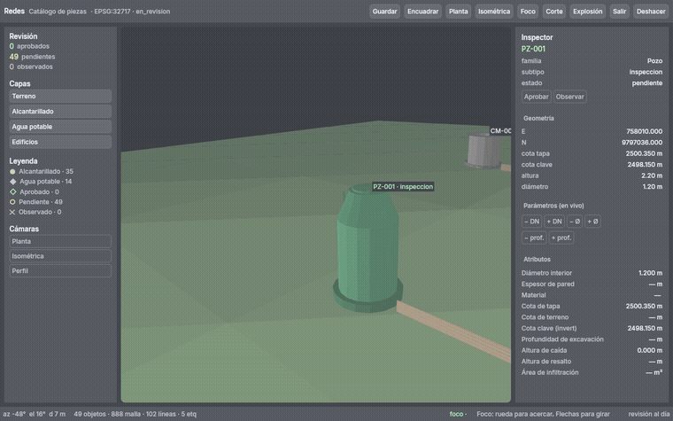
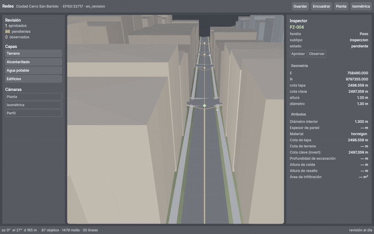
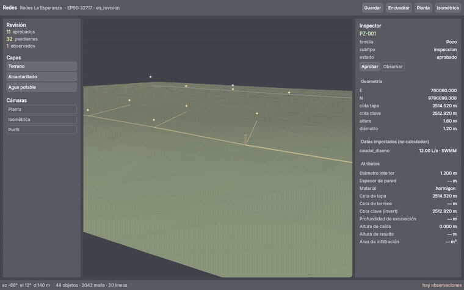
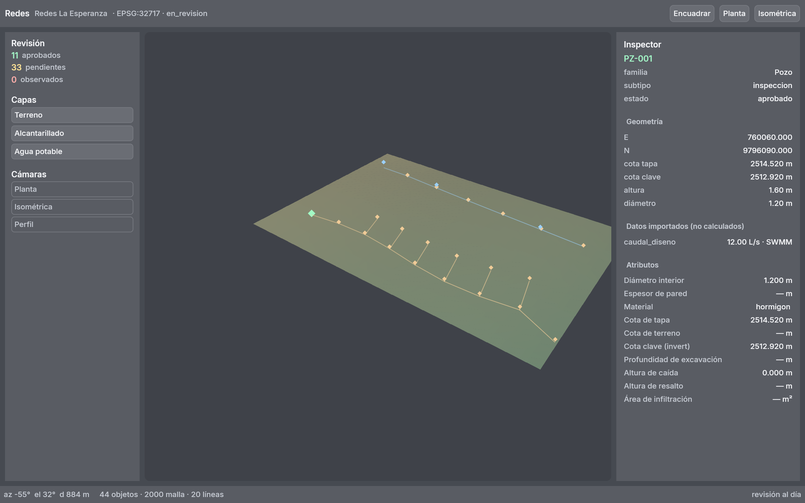
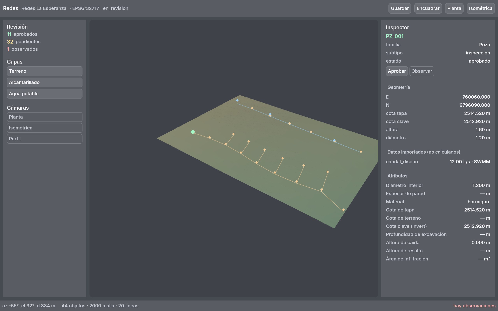

# Redes — visor 3D de redes de agua potable y alcantarillado

Aplicación de escritorio en **Rust + Rune** para **ver, revisar y aprobar en 3D** redes de agua
potable y alcantarillado que ya fueron diseñadas en otras herramientas, y para **devolverlas al
CAD** en DXF con el detalle listo para DWG.

> **Límite duro del producto:** aquí no se calcula hidráulica, hidrología, movimientos de tierra
> ni presupuesto. Los números vienen del archivo de origen y se muestran con su procedencia. El
> cálculo ocurre en las aplicaciones que ya lo hacen bien; esta app es la mesa de revisión.

```
otras apps            skill de ingesta              Redes                    CAD
──────────            ────────────────              ─────                    ───
Civil 3D  ─┐                                    ┌─ vista 3D          ┌─ DXF ─► DWG
SWMM      ─┼─►  redes.plan/1  ──►  CLI `redes` ─┼─ revisión/aprobación┤
EPANET    ─┤    (o DXF/GeoJSON)                  └─ datos importados  └─ GeoJSON ─► SIG
Excel     ─┘
```

## Catálogo de piezas (paramétrico)

[](docs/img/catalogo.mp4)

Las piezas no son cajas: se generan a partir de sus parámetros (diámetro, profundidad, DN,
ángulo) y cambian de nivel de detalle según su tamaño en pantalla.

```powershell
cargo run -p redes-cli --release -- proyecto catalogo --salida out\catalogo.redes
$env:REDES_PROJECT = "out\catalogo.redes"
cargo run -p redes-app --release
```

| Pieza | Qué se dibuja |
|---|---|
| Pozo (inspección, caída, resalto, ciego, bombeo, limpieza) | solera, fuste, **cono**, marco, tapa, escalera; caída con tubo adosado |
| Válvula (compuerta, mariposa, retención, aire, RP) | cuerpo horizontal, bridas, vástago y volante / palanca / campana |
| Tubería | tubo con juntas cada 6 m, recortado en la pared del pozo |
| Descarga | muro de cabeza, alas inclinadas, losa disipadora |
| Hidrante, tanque, cámara, sumidero, medidor | cuerpo, bonete, bocas, cubierta, rejilla, carátula |
| Accesorios | codo, tee, cruz, reducción, unión, tapón |
| Tapa, escalera, arqueta, caja, arenero, trampa, dado | marco y tapa, peldaños, caja con cubierta |

El registro pasó de 18 a **46 familias y 315 subtipos** (29 + las 17 de la cadena de agua cruda: captación, conducción, pretratamiento, tratamiento y salida del alcantarillado) y el detalle está presupuestado por nivel (símbolo /
simple / completo). Decisiones y comparación de motores en
[10-sintesis-detalle.md](docs/10-sintesis-detalle.md).

## Modos de inspección (fase 2 y 3)

[](docs/img/modos.mp4)

| Botón | Qué hace |
|---|---|
| **Foco** | lleva la cámara a la pieza y dibuja a escala real (`z_scale = 1`) |
| **Corte** | plano vertical por el centro: recorta la geometría y marca la arista en amarillo |
| **Explosión** | separa solera, cono y tapa en bandas |
| **Salir** | vuelve al encuadre general |
| **Deshacer** | revierte el último cambio de revisión o de modelo asignado |

Además: **etiquetas** con código y subtipo sobre cada pieza visible, **leyenda** por forma y
texto (no solo color) e inspector de **solo lectura**: la app no edita el diseño (D12).
`Shift + rueda` mueve el plano de corte o abre la explosión.

Detalle y limitaciones en [11-modos-inspeccion.md](docs/11-modos-inspeccion.md).

## Revisión del consejo y cierre de fases

Tres revisiones independientes (arquitectura, visual, pruebas) encontraron cuatro defectos
bloqueantes en las fases 1‑3: precisión de las tuberías en `f32` con UTM, siete familias que no se
dibujaban, corte que no cortaba tubos y el índice del TIN perdido al abrir un archivo. **Los cuatro
están corregidos**; el detalle y lo que queda abierto está en
[15-informe-revision.md](docs/15-informe-revision.md).

## glTF y pase 3D con profundidad (fases 4 y 5)

```powershell
# Modelo para Blender / three.js / cualquier visor (una primitiva por familia)
.\target\release\redes.exe -p out\ciudad.redes exportar gltf --salida out\ciudad.glb

# Visor con búfer de profundidad (más rápido en escenas grandes y en corte)
.\target\release\redes-app.exe --gpu3d --abrir out\ciudad.redes
```

| Escena | 2D (pintor) p95 | 3D (`--gpu3d`) p95 |
|---|---|---|
| ciudad | 33,9 ms | **2,3 ms** |
| corte | 247,0 ms | **2,5 ms** |

El `.glb` de la ciudad pesa 1,1 MB, tiene 20 primitivas y 26 810 triángulos, y **se verificó
importándolo en Blender 5.1 headless**. Detalle en
[16-fase-4-5-gltf-y-3d.md](docs/16-fase-4-5-gltf-y-3d.md).

## Modelos propios (Blender)

Un `.glb` de Blender se puede revisar antes de integrarlo:

```powershell
.\target\release\redes.exe biblioteca revisar --glb mi_valvula.glb --familia agua.valvula
```

Comprueba escala, base en `z=0`, presupuesto de triángulos y giro, y devuelve avisos con código de
salida ≠ 0 si hay error. El lector `.glb` y el validador ya están; la integración en el visor
(manifiesto, colocación, anclas) está especificada en
[17-biblioteca-modelos.md](docs/17-biblioteca-modelos.md), con el contrato que debe cumplir el
modelo y el esfuerzo de cada paso.

## Cómo abrirlo

Es una ventana nativa, no una web. **Doble clic en `Abrir Redes (ciudad).bat`** y ya está (compila
la primera vez si hace falta). También:

```powershell
.\target\release\redes-app.exe --abrir demo\ciudad-san-bartolo.redes
```

Detalle en [COMO-ABRIR.md](COMO-ABRIR.md).

## Arranque rápido

```powershell
# 1. Proyecto de demostración (red de alcantarillado + red de agua potable + terreno)
cargo run -p redes-cli -- proyecto demo --salida out\la-esperanza.redes

# 1b. Ciudad de demostración: ladera montañosa, calles, manzanas y redes con cotas reales
cargo run -p redes-cli -- proyecto ciudad --salida out\ciudad.redes

# 2. Vista 3D del modelo (SVG, sin GPU — sirve también a un agente)
cargo run -p redes-cli -- -p out\la-esperanza.redes vista --salida out\vista.svg

# 3. Abrir el visor 3D interactivo
$env:REDES_PROJECT = "out\la-esperanza.redes"
cargo run -p redes-app

# 4. Entregar al CAD
cargo run -p redes-cli -- -p out\la-esperanza.redes exportar dxf --salida out\plano.dxf
```

La app también corre headless, para que un agente compruebe su propio trabajo:

```powershell
cargo run -p redes-app -- --snap out\vista.png --scene iso
cargo run -p redes-app -- --tree out\arbol.json
```

## Demo grabada

### Ciudad en ladera (promoción)

[](docs/img/ciudad.mp4)

`docs/img/ciudad.mp4` — «Ciudad Cerro San Bartolo»: topografía montañosa, tres avenidas, siete
calles, 108 edificios y las dos redes. **Las tapas de los pozos están a la cota de la calle** y las
claves van de 1,2 a 6 m bajo tierra con pendiente mínima 0,4 %; el proyecto se genera con
`redes proyecto ciudad` y las reglas están cubiertas por pruebas (`demo_city::tests`).

El recorrido: vista a nivel de calle → alejarse → apagar **Edificios** para ver la red bajo la
ciudad → encender de nuevo → **Observar** el pozo → **Guardar** → planta → isométrica.

### Recorrido por el visor

[](docs/img/demo.mp4)

`docs/img/demo.mp4` (11 s, 1280×800) se grabó con el **grabador headless de Rune**, que es el
equivalente a Playwright para una app nativa: un guion de eventos (`docs/demo/recorrido.json`)
más salida de vídeo. Se reproduce igual con:

```powershell
cargo run -p redes-app --release -- --scene detalle `
  --script docs\demo\recorrido.json --video out\demo.mp4 --duration 11 --pointer
```

El recorrido: orbitar, acercarse a un pozo, **Observar** (cambia el estado, deja nota y marca el
proyecto como modificado), **Guardar**, vista en planta con encuadre, volver a isométrica y
**Aprobar**.

## Qué hay en este repositorio





| Ruta | Qué es |
|---|---|
| `crates/redes-core` | Modelo de objetos por familias, topología, ingesta (plan/DXF/GeoJSON), vista 3D, exportación. **Sin UI y sin cálculo de ingeniería.** |
| `crates/redes-cli` | Binario `redes`: toda la capacidad como CLI con sobre JSON para agentes. |
| `crates/redes-app` | Visor 3D en Rune: órbita, capas, inspector, revisión y aprobación. |
| `docs/01-arquitectura.md` | Arquitectura, decisiones y límites. |
| `docs/02-features.md` | Plan completo de funcionalidades (backlog priorizado). |
| `docs/03-skill-ingesta.md` | **La skill** que convierte datos de otras apps al formato de Redes. |
| `docs/04-guia.md` | Guía de uso: CLI, app, flujo de aprobación. |
| `docs/00-investigacion-rune.md` | Dossier verificado de Rune (el framework de UI). |
| `docs/consejo/` | Documentos del consejo de arquitectura original (alcance anterior, con cálculos). Se conservan como referencia de dominio. |
| `vendor/rune` | Checkout fijado de Rune (`78efd4a`), sin modificar. |

## Licencia

MIT — ver [LICENSE](LICENSE). Copyright (c) 2026 Jonathan Torres Vázquez.

El checkout de Rune en `vendor/rune` conserva su propia licencia (MIT/Apache-2.0 según el
framework); no se modifica.

## Repositorio

- Una sola rama, `main`.
- Las ramas de trabajo se nombran con el ticket: `mam-1066-campo-modelo`, `mam-1068-modelo-en-3d`…
  Linear ya genera ese nombre para cada ticket (campo `gitBranchName`).
- `target/` y `out/` no se versionan; el árbol de Rune sí (para compilar sin red).
- Commits en imperativo y en español, con el identificador del ticket al principio:
  `MAM-1066: añade modelo al nodo y biblioteca al proyecto`.

## La cadena completa

`redes proyecto cadena` genera una red de demostración que va **desde la captación hasta la planta de
tratamiento y la descarga**: bocatoma en la quebrada, desarenador, línea de conducción con cámaras de
carga y de quiebre, PTAP (mezcla, floculación, sedimentación, filtración y desinfección), reservorio,
red de distribución y, en paralelo, el alcantarillado hasta la PTAR (reja, desarenador, reactor UASB,
sedimentador y laguna de maduración).

En la app: `--scene ptap` y `--scene ptar` enfocan la planta y la salida del alcantarillado.

## Estado

Release 0.1.0 publicada. Registro de 46 familias y 315 subtipos; importa el plan
(`redes.plan/1`) y el DXF propio, dibuja en 3D (con pase de profundidad `--gpu3d`), valida la
geometría, revisa y aprueba objeto a objeto, saca perfil, acta y cantidades, y exporta DXF
(ida y vuelta sin pérdida), GeoJSON y glTF. Qué está hecho y qué falta, con las cifras:
[docs/23](docs/23-estado-y-pendientes.md) y [docs/21](docs/21-cifras-medidas.md). Rune está en
pre-release y se consume fijado a una revisión de `dev`.
