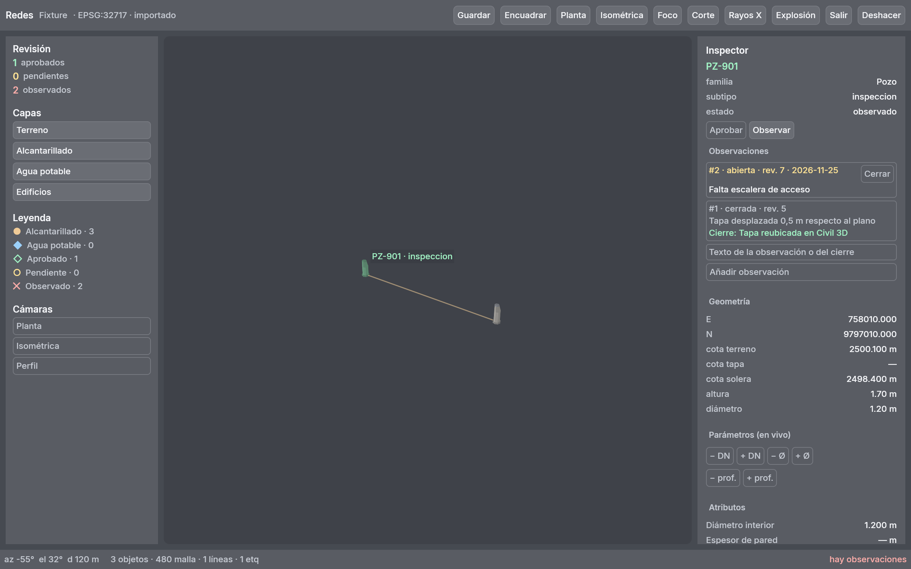
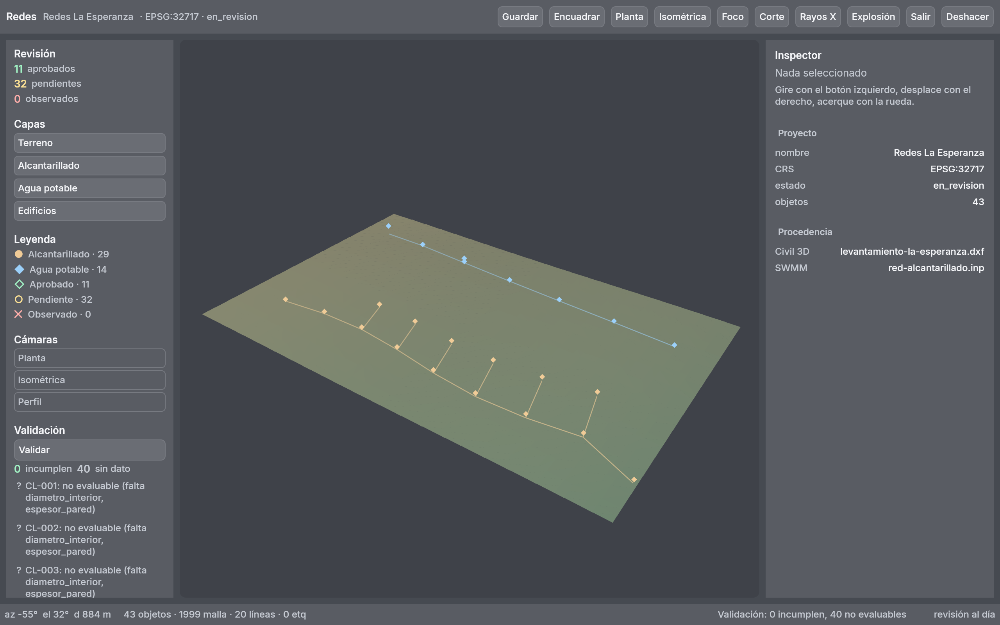

# 04 — Guía de uso

> Para quien va a **ver, revisar y entregar** una red: ingeniería municipal, consultoría,
> delineación. 20 minutos de lectura; el arranque son 5.

---

## 1. Qué es y qué no es

**Es** un visor 3D de redes ya diseñadas: importa el modelo de otra aplicación, lo muestra sobre
el terreno, permite aprobarlo objeto por objeto y lo devuelve al CAD en DXF.

**No es** un programa de cálculo. No hay hidráulica, ni hidrología, ni cómputos. Si necesita un
caudal, una presión o un volumen, vienen del archivo de origen y la app los muestra con su
procedencia (`SWMM`, `Civil 3D`…). Si el origen no los trae, el inspector muestra `—`.

---

## 2. Antes de empezar

| Requisito | Versión |
|---|---|
| Windows | 10/11 con toolchain MSVC |
| Rust | 1.95 o superior (`rustup` con `x86_64-pc-windows-msvc`) |
| GPU | Cualquiera con DirectX 12 (integrada sirve) |
| Espacio | ~3 GB de `target/` la primera compilación |

```powershell
git clone <repo> ; cd rune-alcantarillado-agua-potable
cargo build --release          # la app necesita release para interactuar fluido
```

La primera compilación tarda varios minutos (compila Rune y wgpu). Es normal.

---

## 3. Arranque en cinco minutos

```powershell
# 1. Un proyecto de ejemplo con terreno, alcantarillado y agua potable
cargo run -p redes-cli --release -- proyecto demo --salida out\la-esperanza.redes

# 1b. La ciudad de demostración (ladera, calles, manzanas y redes)
cargo run -p redes-cli --release -- proyecto ciudad --salida out\ciudad.redes

# 2. Ver el resumen
cargo run -p redes-cli --release -- -p out\la-esperanza.redes proyecto info --pretty

# 3. Abrir el visor
$env:REDES_PROJECT = "out\la-esperanza.redes"
cargo run -p redes-app --release
```

Dentro del visor:

| Acción | Cómo |
|---|---|
| Girar | Arrastrar con el botón izquierdo |
| Desplazar | Arrastrar con el botón derecho (o central) |
| Acercar / alejar | Rueda del ratón |
| Encuadrar todo | Botón **Encuadrar** |
| Vistas fijas | **Planta**, **Isométrica**, botón *Perfil* en el panel izquierdo |
| Apagar una capa | Panel izquierdo → **Capas** |
| Seleccionar un objeto | Clic sobre el pozo o la tubería |
| Leer su ficha | Panel derecho (**Inspector**) |
| Aprobar / observar | Botones del inspector cuando hay algo seleccionado |
| Guardar la revisión | Botón **Guardar** (aparece `Guardar *` si hay cambios) |

---

## 4. La ventana

```
┌───────────────────────────────────────────────────────────────────────────┐
│ Redes   <proyecto> · <CRS> · <estado>          Encuadrar  Planta  Isométrica │
├──────────────┬──────────────────────────────────────────┬─────────────────┤
│ Revisión     │                                          │ Inspector       │
│  · aprobados │            vista 3D                      │  código         │
│  · pendientes│      (terreno + tuberías + pozos)        │  familia/tipo   │
│  · observados│                                          │  estado         │
│              │                                          │  geometría      │
│ Capas        │                                          │  datos de origen│
│  · terreno   │                                          │  atributos      │
│  · alcantar. │                                          │                 │
│  · agua      │                                          │                 │
├──────────────┴──────────────────────────────────────────┴─────────────────┤
│ az -55° el 32° d 884 m · 44 objetos · 2000 malla · 20 líneas   revisión… │
└───────────────────────────────────────────────────────────────────────────┘
```

**Colores:** naranja = alcantarillado; azul = agua potable; verde = objeto seleccionado; rojo =
objeto con observación. El terreno se colorea por cota y se sombrea por pendiente; la exageración
vertical por defecto es 2× (un relieve de 8 m en 600 m no se leería de otro modo); con ciudad es
2,6×.

**City context:** cuando el proyecto trae `entorno` (calles y manzanas), la capa **Edificios**
permite apagarlo para ver las redes bajo la ciudad. Los pozos se dibujan como rombos de tamaño
fijo para que sigan visibles en planta general.

### Cómo se garantizan las cotas

En la ciudad de demostración (`redes proyecto ciudad`) las cotas no son decorativas:

| Regla | Cómo se cumple | Prueba |
|---|---|---|
| La tapa sale a la calle | `z_rim` = cota del terreno en el eje de la calle | `la_tapa_del_pozo_esta_en_la_calle` (±0,35 m) |
| La clave va enterrada | profundidad (tapa − solera) entre 1,1 y 6 m; recubrimiento del tubo (rasante − (solera + DI + espesor)) > 0,5 m | `la_profundidad_del_pozo_es_razonable`, `el_recubrimiento_del_tubo_es_positivo` |
| Todo colector baja | clave decreciente; pendiente ≥ 0,4 % | `todos_los_colectores_bajan` |
| Los laterales acometen al troncal | cada lateral termina en el pozo de su calle | sin arcos colgantes en la importación |

El troncal se diseña aguas abajo (cada pozo baja al menos 0,6 % y nunca queda a menos de 1,2 m de
la tapa); los laterales se diseñan aguas arriba con la clave del troncal como condición de borde.

---

## 5. La CLI

Todo lo que hace la app lo hace la CLI, y al revés. La CLI es la interfaz para agentes: cada
respuesta es un sobre JSON.

```json
{
  "schema": "redes.envelope/1",
  "ok": true,
  "command": "proyecto.info",
  "project": { "name": "Redes La Esperanza", "revision": 1, … },
  "data": { … },
  "diagnostics": [],
  "warnings": [],
  "meta": { "exit_code": 0, … },
  "error": null
}
```

Regla dura: **`ok:false` ⇔ código de salida ≠ 0**.

### 5.1 Proyecto

```powershell
redes proyecto nuevo --nombre "Alcantarillado Norte" --crs EPSG:32717 --salida norte.redes
redes proyecto demo --salida la-esperanza.redes
redes proyecto info --pretty
redes proyecto aprobar          # falla si quedan objetos pendientes (E_STATE_PENDING) u observados, con observaciones abiertas (E_STATE_OBSERVED)
```

Resolución del proyecto: `--project` / `-p` → `$REDES_PROJECT` → el primer `*.redes` de la
carpeta o de sus padres.

### 5.2 Importar

```powershell
# El contrato de la skill: todo lo que viene de otra aplicación entra así (D5)
redes importar plan --archivo plan.json

# La vuelta del DXF que exportó Redes (capa REDES_INFO)
redes importar dxf --archivo plano-devuelto.dxf

# Puntos de terreno E,N,Z (sin --epsg toma el del proyecto)
redes importar terreno --archivo puntos.csv --epsg 32717
```

**Sistema de coordenadas (F12-13).** Redes trabaja en UTM sur WGS 84, en metros
(`EPSG:327NN`; 17S = 32717, 18S = 32718). El plan **declara** su CRS en `proyecto.crs` y no se
supone ninguno. Devuelven `E_CRS` sin tocar el proyecto: un plan sin CRS o con uno que no es UTM
sur (p. ej. 32617, que es 17**N**, o 4326); un plan o un terreno en otro CRS que el del proyecto
(Redes no reproyecta; un proyecto vacío adopta el del primer plan o terreno, y se avisa); y
coordenadas que parecen grados lon/lat (|E| ≤ 180 y |N| ≤ 90).

La app **no adivina** formatos ajenos. Un DXF de Civil 3D, un GeoJSON de un SIG, un `.inp` o un
Excel los adapta un agente con la skill `skills/redes-ingesta`, que escribe un `redes.plan/1`.
`importar dxf` con un DXF que no exportó Redes devuelve `E_FMT_NOT_REDES` (y uno vacío o
truncado, `E_FMT_PARSE`) sin tocar el proyecto.

Cada importación devuelve cuántos entraron, **por qué** se descartó el resto y qué datos
faltaban en lo que entró:

```json
{ "formato": "plan", "nodos": 24, "arcos": 20, "descartados": 0, "detalle_descartes": [],
  "avisos": 1, "detalle_avisos": ["arco C7: sin diametro_nominal (se muestra «—» y se dibuja como línea sin dato)"] }
```

**No se rellena nada (F12-03).** Lo que el plan no trae queda ausente: sin `cota_terreno` no se
usa la solera, sin `cota` (solera) no se pone «terreno − 1,5», la tapa (`cota_tapa`) no se copia
del terreno y sin `diametro_mm` no hay DN 200. El inspector y `objeto lista` muestran `—` (o
`null`) y la vista dibuja «sin dato»: un disco gris plano para el nodo sin altura y una línea gris
fina para el tramo sin DN o sin cota. La única cota que se completa es la de terreno desde el TIN
del propio plan, y se avisa. Un nodo sin ninguna cota se descarta con motivo.

#### Reimportar una entrega nueva sin perder la revisión (F13-06, D9)

```powershell
redes --dry-run importar reimportar --archivo plan-v2.json   # informe, sin escribir
redes importar reimportar --archivo plan-v2.json
redes importar reimportar --archivo plano-devuelto.dxf      # el formato sale de la extensión
redes importar reimportar --archivo plan-v3.json --aceptar-bajas
```

`importar plan` sobre un proyecto que ya tiene esos códigos los descarta como repetidos. Cuando
llega **otra versión del diseño** se usa `importar reimportar`: el diseño se sustituye entero por el
de la entrega (Redes no edita el diseño) y la revisión se traslada emparejando por **código**, con
la misma comparación que `proyecto diff` (tolerancia 0,001 m en cotas y `--tolerancia-pos`, 0,01 m
por defecto, en planta):

| Objeto | Estado | Observaciones |
|---|---|---|
| sin cambios de diseño | se conserva | se conservan |
| con cambios de diseño, **aprobado** | vuelve a **pendiente** (se aprobó otra cosa) | se conservan |
| con cambios de diseño, observado o pendiente | se conserva | se conservan |
| solo cambia la procedencia de un dato (`datos.X.fuente`) | se conserva (se informa) | se conservan |
| alta (código nuevo) | pendiente | — |
| baja (código que ya no viene) | sale del modelo; si tenía revisión, falla con `E_STATE_BAJAS_CON_REVISION` (salida 3) salvo `--aceptar-bajas` | van completas en `data.bajas` |

El sobre trae `data.resumen` (`altas`, `bajas`, `bajas_con_revision`, `cambiados`, `sin_cambios`,
`revision_conservada`, `revision_reiniciada`, `observaciones_conservadas`, `cambia_el_diseno`) y el
detalle en `data.altas`, `data.bajas` (con su estado y observaciones), `data.cambiados` (estado antes
y después, `revision: conservada|reiniciada` y los `cambios` por campo, como en `proyecto diff`),
`data.reiniciados`, `data.estado_proyecto` y `data.importacion` (descartes y avisos de la ingesta).
`--dry-run` hace todo en memoria y devuelve el mismo informe (con la revisión como quedaría) sin
escribir. Un error de la entrega (`E_FMT_*`, `E_CRS`) no toca el proyecto.

Se anota un único `commit` en el journal: `importar.reimportar plan-v2.json: altas 1, bajas 0,
cambiados 2, reiniciados 1 [CL-014]`, y la revisión del proyecto sube en uno. Un proyecto
**aprobado** pasa a `en_revision` si cambió el diseño. Se conservan el terreno (salvo que la entrega
traiga uno), el entorno, la biblioteca y el modelo 3D asignado con `biblioteca aplicar` (y sus datos
con fuente `modelo:<id>`); si el modelo movía los extremos de los tramos a sus anclas, vuelva a
ejecutar `biblioteca aplicar` tras reimportar.

### 5.3 Revisar

```powershell
redes objeto lista --estado pendiente
redes objeto aprobar --codigo PZ-001
redes objeto observar --codigo CL-014 --texto "Revisar cota de salida en campo" [--ubicacion E,N,Z]
redes objeto observaciones --codigo CL-014            # historial: abiertas y cerradas
redes objeto cerrar-observacion --codigo CL-014 --id 1 --texto "Corregida en Civil 3D"
redes objeto aprobar --codigo CL-014 --cerrar-todas "Corregido en origen"
redes objeto reabrir --codigo PZ-001                  # aprobado → pendiente
```

**Observaciones con historial (F13-03).** Cada objeto guarda una lista de observaciones que no se
sobrescriben: `observar` añade una nueva (`#1`, `#2`…) con fecha UTC, revisión del proyecto en que
se abrió y, si se da, el punto (`--ubicacion`). `--nota` sigue valiendo como alias de `--texto`;
el texto es obligatorio (`E_ARG_MISSING`).

- El estado se **deriva**: un objeto está **observado** si y solo si tiene alguna observación
  abierta. Cerrar la última lo deja **pendiente** (aprobarlo es otro acto).
- **Aprobar** con observaciones abiertas falla con `E_STATE_OBS_ABIERTAS`; con
  `--cerrar-todas "texto"` se cierran todas en el mismo comando y se aprueba. `reabrir` con
  abiertas también falla. Cerrar una ya cerrada da `E_STATE_OBS_CERRADA`; un id que no existe,
  `E_STATE_NOT_FOUND`.
- El journal anota código e id: `objeto.observar CL-014 #2`, `objeto.cerrar_observacion CL-014 #1`,
  `objeto.aprobar CL-014 #2` (las que cerró).
- **Sin autor (D2):** la observación solo guarda el usuario del sistema (`autor`, `autor_cierre`)
  si se arranca con `REDES_JOURNAL_USUARIO=1`, igual que el journal.
- El proyecto se guarda como `redes.project/3`. La `nota` única de versiones anteriores no se
  convierte: no hay archivos en producción que conservar.
- En `objeto lista`, GeoJSON y la capa `OBSERVACIONES` del DXF, «nota» es el texto de la última
  observación abierta.

En el visor, el inspector muestra el historial (abiertas arriba, con su botón **Cerrar**), un campo
de texto y **Añadir observación**. El texto del campo sirve de observación nueva o de cierre; el
chip **Observar** con el campo vacío anota «Observado en revisión». **Aprobar** con abiertas no
aprueba: lo explica la barra de estado. Después, **Guardar**.



#### Comparar dos entregas (`proyecto diff`)

```powershell
redes proyecto diff --a entrega-1.redes --b entrega-2.redes
redes proyecto diff --a entrega-1.redes --b entrega-2.redes --tolerancia-pos 0.05 --solo diseno --salida diff.csv
```

Empareja los objetos por **código** (el `ElementId` cambia entre entregas) y reporta altas, bajas y,
por objeto, los campos que cambiaron: familia y subtipo, posición, cotas (tolerancia 0,001 m), DN,
atributos, datos (valor, unidad y fuente), tramo (desde, hasta y vértices) y los datos ausentes:
un dato que aparece o desaparece (`—`) es un cambio. Un movimiento en planta menor que
`--tolerancia-pos` (0,01 m por defecto) no se reporta.

Los campos de revisión llevan `clase: "revision"`: `estado` y cada observación por su id
(`observaciones.2`, con `abierta: texto` o `cerrada: texto` antes y después; `—` si no existía); el resto es `clase: "diseno"`. `--solo diseno|revision` filtra por clase. Dos
proyectos con CRS distinto dan `E_STATE_CRS_DISTINTO` (código de salida 3).

El sobre `redes.envelope/1` trae `data.resumen` (altas, bajas, objetos modificados, cambios por clase
y `por_familia`) y el detalle en `data.altas`, `data.bajas` y `data.modificados[].cambios[]`
(`campo`, `antes`, `despues`, `clase`), en orden determinista (nodos antes que tramos, por código).
`--salida` escribe un CSV con BOM y `;`, una fila por cambio, alta o baja.

### 5.3.1 Validar la geometría (F13-01)

```powershell
redes validar                                     # todas las reglas, umbrales del proyecto o de referencia
redes validar --solo pendiente,recubrimiento      # solo esas reglas
redes validar --reglas umbrales.json              # umbrales propios (los que falten: proyecto → referencia)
redes validar --reglas umbrales.json --guardar    # y los deja en el proyecto (--dry-run no guarda)
```

Son las comprobaciones que el revisor haría a mano sobre los **datos importados**: no calcula
hidráulica ni verifica la norma. Es un informe: sale `ok:true` aunque haya hallazgos; solo falla
con una regla desconocida en `--solo` (`E_ARG_INVALID`, código 2) o un archivo de reglas ilegible,
con un campo que no existe (`E_FMT_CAMPO`) o con un umbral sin sentido (`E_FMT_PARSE`).

| Regla (`--solo`) | Qué mide | Umbral por defecto |
|---|---|---|
| `contrapendiente` | tramo de gravedad cuya solera sube en el sentido declarado (grave) | 0 |
| `pendiente` | (solera inicio − solera fin) / longitud en planta, por sistema | sanitario 0,5–15 %; pluvial y canal 0,3–15 %; combinado 0,3–15 % |
| `salto_pozo` | solera de llegada − solera del pozo, si el subtipo no es de caída (los que exigen `altura_caida`) | 0,75 m |
| `recubrimiento` | rasante − (solera + DI + espesor) en cada vértice; rasante = terreno del nodo en los extremos o el TIN | alcantarillado 1,0 m; agua 0,8 m |
| `profundidad_pozo` | tapa (o terreno si no hay tapa) − solera | 5,0 m |
| `separacion` | agua potable a menos de la horizontal de un colector: se exige el agua por encima con la vertical mínima (fondo exterior del agua − clave exterior del colector); agua por debajo = grave | 3,0 m y 0,30 m |
| `dn_aguas_abajo` | DN de salida de un nodo menor que el de una llegada en gravedad | — |
| `tramo_huerfano` | tramo con un extremo inexistente o borrado (grave) | — |
| `nodo_aislado` | nodo de red sin tramos ni enlaces | — |
| `longitud` | longitud declarada (`attrs.longitud` o `datos.longitud`) contra la medida en planta o 3D (la más próxima) | máx(0,5 m; 1 %) |

**Los umbrales por defecto son una referencia típica, no una norma: ajústelos a la suya.** El
archivo de `--reglas` usa las claves de `data.umbrales` de la respuesta (p. ej.
`{"profundidad_max_pozo_m": 6.0, "pendiente_sanitario": {"min": 0.004, "max": 0.12}}`); con
`--guardar` se guardan en el campo `reglas_validacion` del proyecto (los `.redes` anteriores, sin
él, abren con los de referencia).

**Nunca un valor supuesto.** Si falta un dato para evaluar una regla en un objeto, el hallazgo es
`no_evaluable` con `falta` (p. ej. `espesor_pared`, `cota_solera`, `rasante (terreno del nodo o
TIN)`). El DN no se usa como diámetro interior ni se pone un espesor típico. Única excepción, la
**cota segura**: si aun sin contar lo que falta la regla ya se incumple (el recubrimiento sobre la
solera ya es menor que el mínimo), el incumplimiento es cierto y el mensaje dice qué no se contó.

Cada hallazgo trae `regla`, `severidad` (`grave`, `aviso`, `no_evaluable`), `objetos` (códigos; el
primero es el principal), `medido`, `umbral`, `unidad`, `mensaje` y `ubicacion` `[E, N]`; `resumen`
da por regla los `evaluados`, `incumplen` y `no_evaluables`. La separación busca los pares cercanos
con una rejilla (no compara todos los tramos entre sí).

En la app, el panel izquierdo tiene **Validación → Validar**: muestra el recuento y la lista de
hallazgos (✕ grave, ▲ aviso, ? sin dato); un clic selecciona el objeto y lleva la cámara a la
ubicación. La lista es la de la última pulsación: tras editar, vuelva a validar. Captura:
`cargo run -p redes-app -- --snap docs\img\validacion.png --scene validar`.



### 5.4 Grabar una demo (o una prueba de interfaz)

No hace falta Playwright: la app se graba a sí misma. Un guion de eventos y la bandera `--video`:

```powershell
# docs/demo/recorrido.json describe los clics, arrastres y rueda
cargo run -p redes-app --release -- --scene detalle `
  --script docs\demo\recorrido.json `
  --video out\demo.mp4 --duration 11 --pointer
```

- `--script` admite `click`, `drag`, `wheel`, `key`, `type` y `paste`, con `key` (nombre de un
  elemento) o `x`/`y` en puntos de la ventana.
- `--pointer` dibuja el ripple del clic; `--keys` superpone las teclas.
- `--snap` toma una foto en un instante y `--tree` vuelca el árbol de elementos: con eso se
  verifica una interfaz headless, sin abrir ventana.
- Los chips y botones tienen claves estables (`btn-aprobar`, `btn-observar`, `btn-guardar`,
  `btn-planta`, `btn-iso`, `btn-encuadrar`, `btn-anadir-obs`, `btn-cerrar-obs-N`, campo
  `obs-texto`) para que un guion los encuentre.

Resultado: [demo.mp4](img/demo.mp4) y su vista previa [demo.gif](img/demo.gif).

### 5.5 Ver sin abrir la app

```powershell
redes vista --salida vista.svg --azimut -55 --elevacion 32
```

Es la misma escena 3D que dibuja la app, en SVG: se abre en el navegador y un agente puede
inspeccionarla o convertirla a PNG.

#### Perfil longitudinal

```powershell
redes -p red.redes perfil --desde PZ-001 --hasta PZ-008 --salida perfil.svg
redes -p red.redes perfil --tramos CL-001,CL-002,CL-003 --exageracion 20 --paso 5
```

Dibuja el perfil de un colector: rasante (cota de terreno de cada pozo y muestreo del TIN entre
pozos, cada `--paso` m, 10 por defecto; 0 = solo pozos), tubo entre solera y clave, pozos, y una
tabla con abscisa, terreno, tapa, solera, profundidad, y por tramo DN, longitud y pendiente
(S %). `--exageracion` es la exageración vertical (10 por defecto). El recorrido sigue el
**sentido declarado** de los tramos: `--desde/--hasta` busca el camino más corto aguas abajo y
`--tramos` exige tramos consecutivos; si no, error `E_TOPO_SIN_RUTA` o `E_TOPO_NO_CONSECUTIVO`.
El JSON del perfil va en `data.perfil` del sobre `redes.envelope/1`.

No calcula nada: la pendiente sale de las soleras declaradas del tramo y la clave es solera +
diámetro interior. Si falta una solera, el tramo queda sin tubo, sin pendiente (`—`) y marcado
«sin cota de solera»; un pozo sin cota muestra `—`. Nada se interpola como dato; la única cota
que no es de un objeto es la rasante muestreada del TIN (`origen: "tin"` en el JSON).

En la app, el botón **Perfil** del inspector de un tramo abre el perfil de su colector (de la
cabecera a la descarga; en una bifurcación sigue el tramo de mayor DN) en un panel inferior, con
el dibujo y la tabla; **Cerrar perfil** lo quita. El SVG con rótulos completos sale de la CLI.

### 5.6 Entregar

```powershell
redes exportar dxf --salida plano.dxf                     # todo el modelo
redes exportar dxf --salida aprobado.dxf --solo-aprobados # sólo lo aprobado
redes exportar geojson --salida red.geojson               # para SIG, con los datos de origen
```

El DXF es el que se abre en AutoCAD/Civil 3D/BricsCAD para el **detallado y el DWG final**
(R12 ASCII, `$INSUNITS = 6` metros, `$DWGCODEPAGE = ANSI_1252`, extensión declarada para que
«Zoom extensión» encuadre la red):

- **Capas** declaradas en la tabla LAYER, una por familia y sin tildes (`PZ_POZO`, `CL_TUBERIA`,
  `TB_TUBERIA_DE_AGUA_POTABLE`…), con color ACI por sistema: agua potable 5 (azul), sanitario 30
  (naranja), pluvial 3 (verde, sufijo `_PLU` cuando la familia es de saneamiento), combinado 6,
  común 8. Rotulación aparte en `ROT_<AP|SAN|PLU|COMB|COM>_TRAMOS` y `ROT_…_NODOS`.
- **Nodos**: bloque con círculo del diámetro interior declarado (radio = DI/2; sin DI declarado,
  símbolo a escala 1) y atributos ocultos `CODIGO`,
  `SUBTIPO`, `COTA_TAPA`, `COTA_SOLERA`, `PROFUNDIDAD`; punto en la solera; línea vertical que baja
  de la tapa a la solera. Rótulo: código, `CT` (tapa), `CS` (solera) y `H` (profundidad).
- **Tramos**: polilínea 3D y rótulo `código DN200 PVC L=45.20 m i=0.50 %`. La pendiente es la
  declarada (atributo `pendiente`); si no hay, se deriva de las soleras declaradas del tramo
  (inicio y fin) y la longitud en planta y se marca `(soleras)`; si hay las dos y no cuadran, salen
  ambas (`i=2.00 % (soleras 0.00 %)`): es una discrepancia, no se corrige.
- **Solo lo que existe**: si falta un dato (DN, material, una cota) no se escribe; nunca se inventa.
- **`OBSERVACIONES`** (rojo): código, estado y última observación abierta de cada objeto
  observado; los observados llevan además un círculo (nube) alrededor.
- **`REDES_INFO`** (apagada): la carga de la ida y vuelta que lee `redes importar dxf` (familia,
  subtipo, código, atributos y datos de nodos y tramos).
- Texto de 1,0 m (2 mm a 1:500). Lo visible es ASCII: las tildes de los textos van como `\U+00ED`,
  que el CAD muestra como «í». Solo la carga de `REDES_INFO` va en UTF-8 tal cual (es para el
  importador; en el CAD puede verse con caracteres raros, como `m³`).

---

## 6. Flujo de aprobación

```
importar  →  revisar en 3D  →  aprobar / observar  →  proyecto aprobar  →  exportar
                │                     │
                │                     └─ observado: vuelve a la app de origen
                └─ pendiente: nadie lo ha mirado
```

1. Importar (los objetos nacen **pendientes**).
2. Recorrer el modelo con la lista de pendientes y la vista 3D.
3. Aprobar lo correcto; observar lo que debe corregirse en la herramienta de diseño.
4. `redes proyecto aprobar` verifica que no quede nada pendiente ni observado (ninguna
   observación abierta).
5. Exportar a DXF y entregar.

**Por qué por objeto y no un botón:** el acta de revisión debe poder decir qué se aprobó y qué
no. Un «aprobar todo» convierte la revisión en un trámite.

---

## 7. Entrada de datos desde otras aplicaciones

Los formatos ajenos los convierte un agente con la skill `skills/redes-ingesta` a un plan
`redes.plan/1`, que se valida e importa con `redes importar plan` (D5). La skill tiene una
referencia por formato en `skills/redes-ingesta/references/`:

| Origen | Camino | Referencia |
|---|---|---|
| DXF escrito por Redes (capa `REDES_INFO`) | `redes importar dxf` | — |
| Civil 3D / AutoCAD (DXF ajeno, LandXML) | skill → `importar plan` | `dxf-civil3d.md` |
| SWMM | skill → `importar plan` | `swmm.md` |
| EPANET | skill → `importar plan` | `epanet.md` |
| Excel / CSV / informes de Civil 3D | skill → `importar plan` | `tablas.md` |
| SIG (GeoJSON, Shapefile) | skill → `importar plan` | `geojson-sig.md` |
| Terreno `E,N,Z` | `redes importar terreno` | — |

Contrato del plan: `references/plan.md`. Procedimiento y reglas: `skills/redes-ingesta/SKILL.md`.

**Regla:** un nodo sin planta no se dibuja ni se coloca en (0,0): se pide la coordenada o se
descarta con su motivo. Sin planta no hay 3D.

---

## 8. Problemas frecuentes

| Síntoma | Causa | Solución |
|---|---|---|
| «E_CRS» al importar | El plan no declara CRS, no es UTM sur (`32617` es 17**N**), no coincide con el proyecto o trae grados lon/lat | Declarar `EPSG:32717` (17S) o `EPSG:32718` (18S) y coordenadas UTM en metros; reproyectar en origen |
| Todo apilado en un punto | El origen no traía coordenadas | Pasar `--coords` a la skill |
| «E_TOPO_ORPHAN_LINK» | Un arco apunta a un nodo que no entró | Revisar `desde`/`hasta` en el plan |
| «E_STATE_DUPLICATE_NAME» | Código repetido | Renombrar en el origen |
| El pozo sale como un disco gris plano | Falta la solera, o faltan a la vez tapa y terreno | Declarar `cota` (solera) y `cota_terreno`/`cota_tapa` en el plan, o el TIN |
| El tramo sale como una línea gris fina | Le falta el DN o la cota de solera (ni la suya ni la de los pozos) | Declarar `diametro_mm` y `cota_solera_inicio/fin` |
| El inspector muestra `—` | El origen no traía ese dato | Es correcto: no se inventa |
| Un nodo aparece en `detalle_descartes` «sin ninguna cota» | No trae solera, tapa ni terreno, y no hay TIN en su planta | Darle al menos una cota en el plan |
| La app va lenta al girar | Compilada en debug | `cargo build --release` y usar `--release` |
| «E_FMT_NOT_REDES» al importar un DXF | El DXF no lo exportó Redes (no trae la capa `REDES_INFO`) | Adaptarlo con la skill de ingesta e `importar plan` |

---

## 9. Glosario mínimo

| Término | Significado |
|---|---|
| **Pozo** | Cámara de registro de alcantarillado (manhole) |
| **Colector** | Tubería de alcantarillado por gravedad |
| **Emisario** | Tramo final hasta el cuerpo receptor |
| **Vertedero / descarga** | Estructura de entrega o alivio |
| **Llave** | Dispositivo en la frontera red–usuario (corporación, banqueta, hidrante) |
| **Válvula** | Dispositivo dentro de la red (compuerta, mariposa, retención, aire…) |
| **Cota de solera (invert)** | Fondo interior de la tubería o del pozo |
| **Cota de clave** | Punto más alto del interior de la tubería (clave = solera + DI). No es la solera |
| **Cota de tapa** | Boca del pozo / rasante |
| **CRS** | Sistema de referencia de coordenadas (aquí UTM) |
| **TIN** | Malla triangular del terreno |
| **Dato** | Número que vino de otra app, con unidad y fuente; nunca se recalcula |

---

## 10. Límites (leer antes de prometer)

1. **No calcula.** Ni hidráulica, ni hidrología, ni excavación, ni presupuesto.
2. **No verifica cumplimiento normativo.**
3. **No edita el diseño**: se corrige en la aplicación de origen y se reimporta.
4. **No genera DWG nativo**: entrega DXF; el DWG se guarda desde el CAD.
5. **No es colaborativo en tiempo real**: un archivo, un revisor.
6. La vista 3D usa algoritmo del pintor: con geometría que se cruza puede haber algún artefacto
   de orden; el detalle fino se ve en el CAD.
