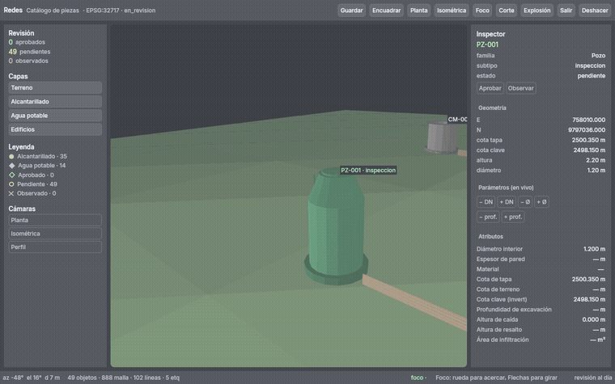
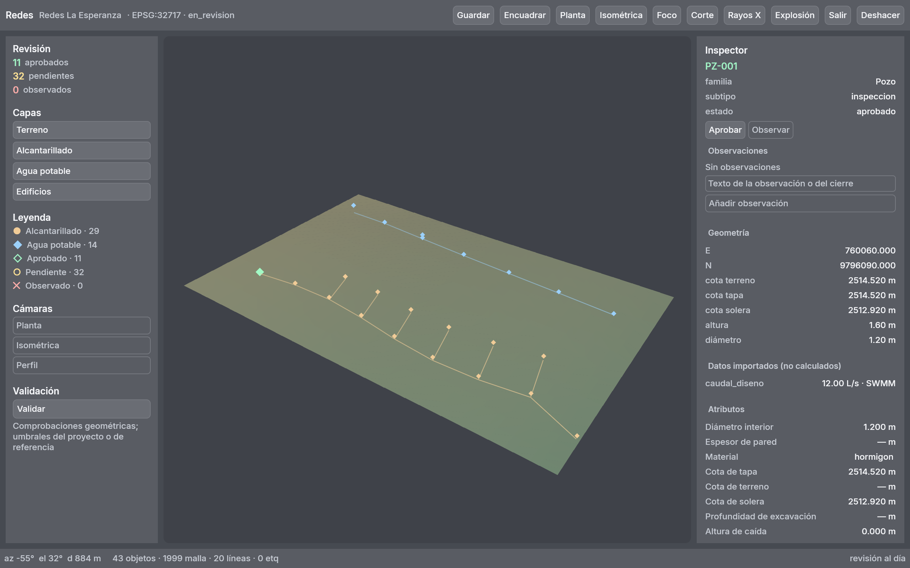

# 11 — Modos de inspección y capa de lectura (fases 2 y 3)

> ⚠️ **Cifras corregidas.** Varios números de este documento se escribieron antes de que el
> código cambiara y ya no son ciertos. Las cifras vigentes, con cómo reproducirlas, están en
> [`21-cifras-medidas.md`](21-cifras-medidas.md). Este documento se conserva como historia.

> Lo que se implementó después del catálogo: ver la pieza por dentro, separarla y leer sus datos.
> Todo dentro del visor, sin otra aplicación. La app **no edita** el diseño (D12).

## 1. Foco

`Foco` (botón) lleva la cámara a la pieza seleccionada:

- encuadre por tamaño de la pieza: `distancia = 3,4 × max(diámetro, altura)`, entre 2,5 y 60 m;
- **`z_scale = 1`** dentro del foco: se dibuja a escala real, sin la exageración vertical de la
  vista general (allí un pozo de 4 m se ve como uno de 10);
- conserva acimut/elevación de la vista general, así el usuario no se desorienta.

`Salir` vuelve al encuadre general y restaura `z_scale` (2,0 o 2,6 con ciudad).

## 2. Corte

`Corte` activa un **plano vertical** por el centro del objeto seleccionado. No es transparencia:
se recorta la geometría contra el semiplano y se dibuja la **arista de corte** en amarillo.

- `Shift + rueda` desplaza el plano (2 cm por punto de rueda).
- Sirve para ver el interior real del pozo: espesor de pared, escalera, banqueo, tubos entrando.
- El recorte es por triángulo (Sutherland-Hodgman en el semiplano), así que también corta tubos.
- La cara de corte lleva **poché**: una trama de rayitas que la hace leer como sección (F10-02).

## 2.1 Rayos X

`Rayos X` (botón de la barra superior, clave `btn-rayos-x`; o `--rayos-x` al arrancar) dibuja
**translúcido lo enterrado** de cada pozo: solera, fuste y escalera pasan a opacidad 0,35, así se
ve lo que queda por debajo de la rasante sin cortar. El botón muestra `Rayos X *` mientras está
activo y la barra de estado lo avisa. No cambia el proyecto (F10-04).

## 3. Explosión

`Explosión` separa la pieza enfocada **por partes nombradas**, no por bandas de altura:

- Pozo: `solera`, `fuste`, `cono`, `marco`, `tapa`, `escalera` y el accesorio del subtipo
  (tubo de caída, resalto, bombas, cubeta de arenero, dado disipador).
- Válvula: `cuerpo`, `bridas`, `accionamiento` (volante, palanca, campana o diafragma).

El reparto es proporcional al número de partes: la pila se abre ~0,85 de la altura de la pieza,
así que con 6 partes la tapa queda a media altura y nada se sale de cuadro. `Shift + rueda` abre o
cierra el factor (0–2,5). Si el objeto no está despiezado, se muestra como una sola parte.

La lista de partes sale de `pozo_partes()` y `valvula_partes()` en `redes-core::parts`, y `pozo()`
/ `valvula()` las unen para el dibujo normal: la misma fuente para las dos vistas.

## 4. Etiquetas

Cada objeto cuya pieza ya se distingue en pantalla (radio proyectado > 9 px) o que está
seleccionado recibe una etiqueta con `código · subtipo`.

- Presupuesto: **24 etiquetas** como máximo, las más cercanas; la del objeto seleccionado se
  dibuja al final para que nada la tape.
- Se reparten en **7 carriles** sin solaparse; si una se mueve de su sitio, una línea guía la une
  a su pieza, y la que no cabe en ningún carril se omite en vez de pisar otra (F10-03).
- Se dibujan como texto real (capa superpuesta al canvas), no como parte de la malla: se leen a
  cualquier zoom y no engordan el triángulo.

## 5. Leyenda accesible

La leyenda del panel izquierdo usa **forma + texto**, no solo color:

| Glifo | Significado |
|---|---|
| ● | Alcantarillado (n objetos) |
| ◆ | Agua potable (n objetos) |
| ◇ | Aprobado |
| ○ | Pendiente |
| ✕ | Observado |

Los conteos salen del proyecto en vivo; al aprobar u observar, la leyenda cambia.

## 6. Ficha del objeto (solo lectura)

El inspector muestra los datos del objeto (geometría, datos importados con su fuente y
atributos) **sin controles para cambiarlos**. Hubo un bloque **Parámetros (en vivo)** con
`− DN`, `+ DN`, `− Ø`, `+ Ø`, `− prof.`, `+ prof.` que escribía en el proyecto (journal
`ui.parametro`) e inventaba un DN de 200 mm cuando faltaba el dato; se retiró el 27/11/2026
porque la app no edita el diseño (D12, `docs/22-decisiones.md`). Lo que no cuadra se marca como
observación y se corrige en la aplicación de origen. Prueba:
`el_inspector_no_edita_parametros_del_diseno`.

## 7. Deshacer

`Deshacer` recupera el proyecto anterior de una pila de **20 pasos**. Cubre la revisión hecha
en el inspector (observaciones) y el modelo de biblioteca elegido.

## 8. Verificación

Pruebas automáticas que sostienen estos modos:

| Prueba | Qué comprueba |
|---|---|
| `el_corte_parte_un_triangulo_en_dos` | el recorte devuelve 2 triángulos y una arista |
| `el_corte_descarta_lo_que_queda_entero_al_otro_lado` | nada sobrevive al otro lado del plano |
| `el_corte_reduce_la_geometria_dibujada` | la escena cortada tiene menos triángulos |
| `la_explosion_separa_las_partes_del_objeto_enfocado` | mismos triángulos, geometría desplazada |
| `las_etiquetas_son_pocas_y_tienen_texto` | ≤ 28 etiquetas, texto y posición finitos |
| `el_boton_foco_acerca_la_camara` | distancia < 20 m y `z_scale = 1` |
| `el_boton_corte_activa_y_desactiva_el_plano` | ida y vuelta del plano |
| `el_boton_explosion_separa_la_pieza` | factor de explosión > 0 |
| `el_inspector_no_edita_parametros_del_diseno` | con selección no hay controles de DN, Ø ni profundidad (D12) |
| `salir_del_modo_vuelve_a_la_vista_general` | cámara y opciones limpias |

Escenas headless para revisar sin tocar el ratón: `--scene foco`, `--scene corte`,
`--scene explosion`.

## 9. Lo que sigue

Lo que esta sección daba por pendiente ya está hecho en F10: el poché en la cara de corte (§2) y
las etiquetas en carriles sin solapes (§4). Se retiró «Ficha editable para todos los parámetros»:
la app no edita el diseño (D12).
